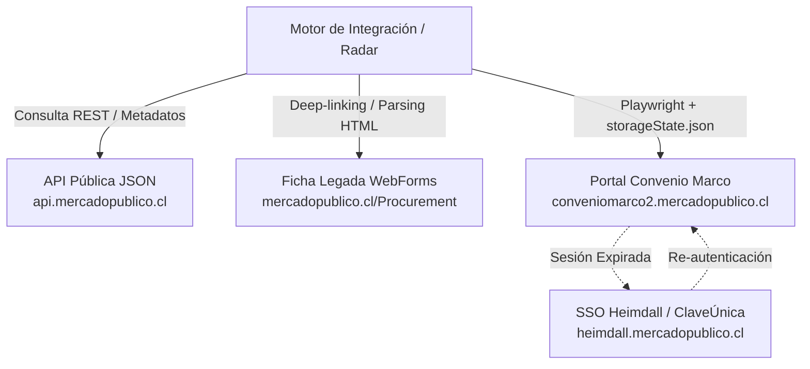
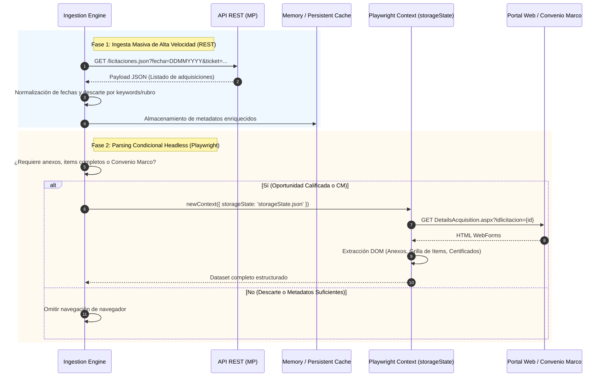

# Especificación Técnica de Integración: Mercado Público Chile

Documento de ingeniería inversa y diseño de integración para ingesta masiva, deep-linking y scraping resiliente sobre la plataforma de compras públicas de Chile (Mercado Público / ChileCompra).

---

## 1. Arquitectura de Endpoints

La plataforma opera bajo una arquitectura heterogénea que combina servicios REST públicos, aplicaciones legadas en ASP.NET WebForms y portales protegidos bajo autenticación federada (SSO).



### 1.1 API Pública JSON (REST)

Canal oficial para descubrimiento y extracción de metadatos de alto nivel sin requerir sesión activa.

- **Endpoint Base:**
  ```http
  GET https://api.mercadopublico.cl/servicios/v1/publico/licitaciones.json
  ```
- **Parámetros de Consulta (Query Params):**
  - `ticket` *(string, obligatorio)*: Token de acceso asignado por ChileCompra.
  - `codigo` *(string, condicional)*: Código de adquisición (ej. `587-32-LE26`, `5802363-9800AAID`). Excluye el uso de `fecha`.
  - `fecha` *(string, condicional)*: Formato estricto `DDMMYYYY`. Recupera el listado del día indicado.
  - `estado` *(string, opcional)*: Filtro por código de estado (`publicada`, `cerrada`, `desierta`, `adjudicada`).

- **Estructura de Respuesta Crítica:**
  ```json
  {
    "Cantidad": 1,
    "FechaCreacion": "2026-10-15T15:30:00",
    "Listado": [
      {
        "CodigoLicitacion": "587-32-LE26",
        "Nombre": "Servicio de Infraestructura Cloud y Soporte",
        "CodigoEstado": 5,
        "Fechas": {
          "FechaCierreRecepcionOfertas": "2026-08-31 15:10:00",
          "FechaCierre": "2026-08-31 15:10:00",
          "FechaFinPublicacion": null
        },
        "Comprador": {
          "CodigoOrganismo": "7032",
          "NombreOrganismo": "Subsecretaría de Telecomunicaciones"
        },
        "Items": {
          "Cantidad": 1,
          "Listado": [
            {
              "Correlativo": 1,
              "CodigoProducto": 81112002,
              "NombreProducto": "Servicios de soporte de sistemas"
            }
          ]
        }
      }
    ]
  }
  ```

- **Limitaciones de la API:**
  - No expone enlaces ni binarios de anexos administrativos o bases técnicas.
  - No indexa licitaciones de Grandes Compras ni cotizaciones privadas de Convenio Marco.
  - Tiempos de refresco con retraso (lag) de hasta 15-30 minutos respecto al portal web.

---

### 1.2 Ficha Legada (HTML / ASP.NET WebForms)

Interfaz web transaccional renderizada por servidor para la visualización integral de bases, anexos y especificaciones técnicas.

- **URL Canónica Directa (1 solo clic):**
  ```http
  https://www.mercadopublico.cl/Procurement/Modules/RFB/DetailsAcquisition.aspx?idlicitacion={codigoLimpio}
  ```
- **URL Alternativa vía Token Encriptado:**
  ```http
  https://www.mercadopublico.cl/Procurement/Modules/RFB/DetailsAcquisition.aspx?qs={qsToken}
  ```

> [!WARNING]
> **Anti-Patrones de Enrutamiento Prohibidos:**
> - `fichaLicitacion.html?code={codigo}`: Conduce a pantalla en blanco por fallas de ejecución en scripts cliente desactualizados.
> - `DetailsAcquisition.aspx?codigoLicitacion={codigo}`: No reconocido por el backend WebForms; retorna HTTP 403 o error `Objeto no encontrado`.
> - Conservar prefijo `CM-` en la query: Provoca desbordamiento de búsqueda en el motor relacional de ASPX. Debe limpiarse vía `codigo.replace(/^CM-/, '')`.

---

### 1.3 Convenio Marco y Módulos Privados

Plataformas de adquisición directa y cotizaciones reservadas (`https://conveniomarco2.mercadopublico.cl`).

- **Mecanismo de Autenticación:** Federada vía SAML/OAuth con pasarela Heimdall (`heimdall.mercadopublico.cl`) y ClaveÚnica (`accounts.claveunica.gob.cl`).
- **Persistencia de Sesión:** Exportación e importación de estado de navegador en `storageState.json` (Playwright Context Storage).
- **Contenido del `storageState.json`:**
  - Cookies críticas: `.ASPXAUTH`, `ASP.NET_SessionId`, cookies de balanceo de carga (`BIGipServer...`), `HeimdallSession`.
  - LocalStorage / SessionStorage: Tokens de estado de catálogo y preferencias de comprador/proveedor.

---

## 2. Estrategia de Ingesta (Hybrid Engine)

Arquitectura desacoplada en dos etapas para optimizar ancho de banda, consumo computacional y tiempos de detección.



### 2.1 Fase 1: Consulta REST/XHR (Metadatos y Filtrado Rápido)

- **Objetivo:** Ingesta masiva en tiempo sub-segundo con costo computacional mínimo ($O(1)$ por lote).
- **Pipeline Operativo:**
  1. Descarga del catálogo diario vía endpoint JSON o consulta directa por código.
  2. Normalización de campos de cierre según tipo de adquisición:
     - **Tradicionales (`LE`, `LP`, `LR`):** Extracción estricta de `FechaCierreRecepcionOfertas` o `Fechas.FechaCierreOfertas`. No utilizar `FechaCierre` genérico ni `FechaAperturaTecnica`.
     - **Convenio Marco (`CM-`):** Extracción de `FechaFinPublicacion` o `FechaCierreCotizacion`.
     - **Compra Ágil / Cotizaciones (`COT`, `AGIL`):** Extracción de `FechaFinPublicacion` o `FechaCierreOfertas`.
  3. Pre-clasificación algorítmica: Filtrado de relevancia mediante keywords, categoría de compra y umbrales de presupuesto estimado.
  4. Deduplicación e indexación en base de datos local / caché.

---

### 2.2 Fase 2: Parsing Condicional vía Playwright (Deep Extraction)

- **Objetivo:** Extracción profunda de anexos, documentos adjuntos y detalle pormenorizado de líneas de producto únicamente para registros seleccionados.
- **Pipeline Operativo:**
  1. Instanciación de contexto aislado en Playwright inyectando `storageState.json`.
  2. Navegación a la URL canónica con timeout configurado a 30s y estrategia `domcontentloaded`.
  3. Extracción de enlaces a bases y anexos:
     - Detección de elementos `<a href*="DownloadFile">` o identificadores en grillas WebForms (`RadGrid` / `GridView`).
     - Almacenamiento seguro de metadatos de archivo (nombre, tamaño, URL directa de descarga).
  4. Extracción de tablas de ítems: parseo de cantidades, unidades de medida, descripciones técnicas y requerimientos mandatorios.
  5. Cierre forzoso del contexto de navegador en bloque `try / finally` para evitar fugas de memoria.

---

## 3. Matriz de Errores y Mitigación

| Código / Error | Causa Raíz | Impacto Operativo | Protocolo de Mitigación |
| :--- | :--- | :--- | :--- |
| **HTTP 429 Too Many Requests** | Ráfagas de consultas a la API pública que superan la tasa de peticiones por ticket. | Bloqueo temporal del ticket (de 60s a 15min) y fallo de ingesta. | 1. Implementar delay preventivo de **300ms** entre peticiones consecutivas.<br>2. Concurrencia máxima acotada a **4 hilos paralelos**.<br>3. Reintentos con **backoff exponencial y jitter aleatorio** (1s a 3s).<br>4. Servir **Stale Cache** si el recurso ya existía en memoria. |
| **Session Expired / Redirección SSO** | Expiración de cookies `.ASPXAUTH` o sesión de Heimdall en portales privados. | Redirección de Playwright a `accounts.claveunica.gob.cl` o `mercadopublico.cl/Home`. | 1. Monitorización de eventos `framenavigated` para detectar URLs de login.<br>2. Interrupción inmediata del scraping para evitar bloqueos por bot.<br>3. Activación del flujo de re-autenticación limpia (CLI interactivo o headless).<br>4. Re-escritura atómica de `storageState.json` y rehidratación de sesión. |
| **HTTP 403 / Pantalla en Blanco** | Uso de parámetros no válidos (`fichaLicitacion.html?code=` o `codigoLicitacion=`). | El usuario o scraper recibe un documento HTML vacío o denegación de acceso. | 1. Forzar generación de enlaces exclusivamente mediante helper `getFichaUrl`.<br>2. Limpiar prefijos no estándar (`cleanOfficialId`).<br>3. Priorizar token `qs` cuando esté presente en el registro. |
| **HTTP 500 / 503 Backend Failure** | Interrupción temporal del servidor IIS / base de datos SQL de ChileCompra. | Respuestas vacías o páginas de error de servidor ASP.NET. | 1. Reintento único con delay estricto de 1000ms.<br>2. Registro de fallo transitorio sin invalidar la sesión guardada.<br>3. Notificación degradada al cliente consumiendo el último snapshot válido. |
| **Producto No Disponible (CM)** | Ficha de cotización eliminada, desierta o perteneciente a otro catálogo. | Selector `body` contiene cadena `"el producto que buscas no se encuentra disponible"`. | 1. Búsqueda secundaria por input superior de formulario en catálogo.<br>2. Fallback a endpoint alternativo `DetailsAcquisitionData.aspx`.<br>3. Marcado del estado como no indexable en la base de datos local. |

